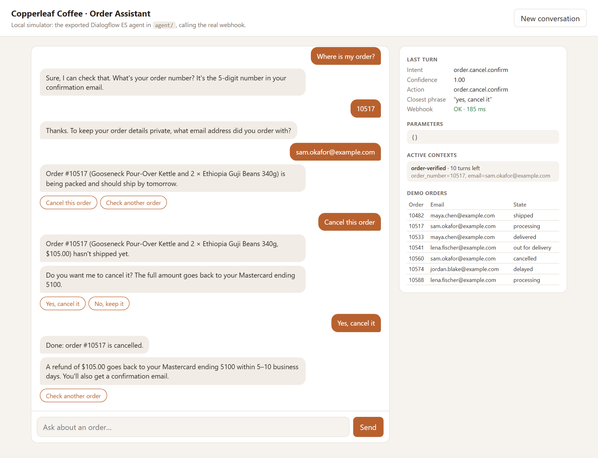
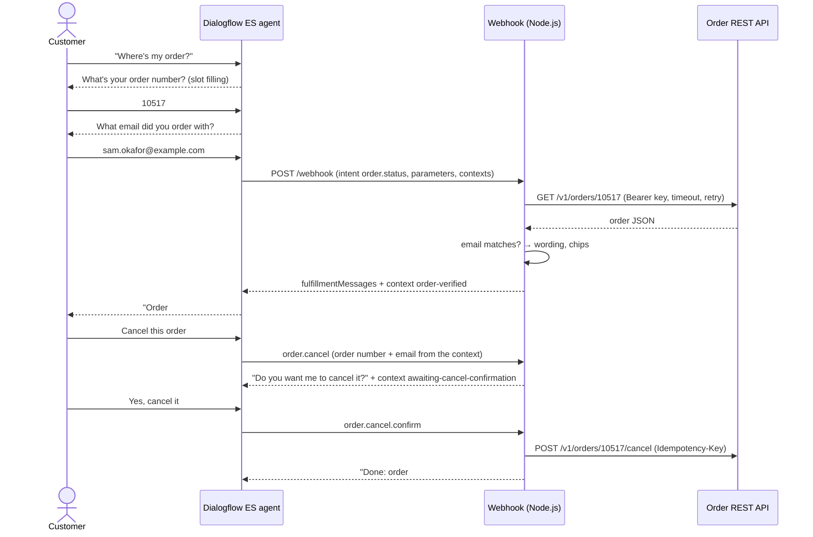

# Dialogflow Order Assistant

A Dialogflow ES agent and a Node.js fulfillment webhook that answer "where is my order?". The bot looks up an order's status, gives tracking details and cancels orders that haven't shipped, all through a REST order API.

"Where is my order?" is the most common question a small online store gets, and answering it means a person copying an order number into the admin panel. This bot handles it in chat. Dialogflow works out what the customer wants and asks for whatever is missing (order number, then email). The webhook gets the order from the store's REST API, **checks that the email matches before showing any details**, and replies with text, suggestion chips and a tracking card. The bot also handles the follow-ups ("track it", "cancel it", "yes") without asking again, and answers sensibly when the order API is slow or down, because Dialogflow stops waiting for a webhook after 5 seconds.

The repo ships with a mock order API and a **local simulator** that runs the exported agent against the webhook. The whole flow works and is tested without a Google Cloud account. The same agent export imports into real Dialogflow.



## How it works



### The agent

The agent is written compactly in [agent-src/definition.js](agent-src/definition.js). `npm run agent:build` generates the Dialogflow ES export in [agent/](agent/) from it (one JSON file per intent and per entity, as Dialogflow's "Export as ZIP" produces). `npm run agent:zip` packs that into an importable ZIP. A test fails if `agent/` is out of date.

| Intent | Webhook | What it does |
| --- | --- | --- |
| `Default Welcome Intent` | – | `WELCOME` event, greeting and suggestion chips |
| `order.status` | ✓ | Required `order_number` (`@order-number`, regex `\b\d{5}\b`) and `email` (`@sys.email`). Prompts for whichever is missing |
| `order.track` | ✓ | Carrier, tracking number, link card and the last three scan events |
| `order.cancel` | ✓ | Cancels only if the order hasn't shipped, and asks for confirmation first |
| `order.cancel.confirm` / `.decline` | ✓ / – | Only match while `awaiting-cancel-confirmation` is active, so a stray "yes" does nothing |
| `support.handoff` | – | Returns, damage, "talk to a person": support contact |
| `conversation.thanks` | – | Closes the chat |
| `Default Fallback Intent` | – | Says what the bot can do |

**Contexts carry the conversation.** After a successful check, the webhook sets `order-verified` (10 turns) with the order number and email. `order.track` and `order.cancel` use `#order-verified.order_number` and `#order-verified.email` as parameter defaults, so "track it" just works. `order.status` reuses only the email, so "where is order 10533?" doesn't ask for it again.

**Static responses are the outage message.** Every webhook intent's static text says the order system can't be reached. Dialogflow shows it when the webhook fails or times out, so the customer never sees "Let me check…" followed by silence.

### The webhook

[src/webhook/](src/webhook/) is an Express app with one `POST /webhook` endpoint that speaks the Dialogflow ES v2 format and has one handler per intent.

- **Verification before disclosure.** Every lookup compares the order's email with the one the customer gave. A wrong email and a nonexistent order get *the same* reply, so the bot never confirms that an order number exists. Emails in replies are masked (`m•••@example.com`).
- **Per-chat lockout.** After `MAX_VERIFY_FAILURES` failed checks within `VERIFY_WINDOW_MINUTES`, the chat stops looking up orders. Guessing which email goes with which order costs a new session every few tries.
- **Re-checked confirmation.** "Yes, cancel it" looks the order up and verifies the email again, because the confirmation context outlives the turn it was set in.
- **Deadline-aware retries.** Dialogflow ES stops waiting after 5 seconds. Every order API call made for one webhook request shares a `WEBHOOK_BUDGET_MS` deadline (4 s). Each attempt gets `ORDERS_API_TIMEOUT_MS` or what's left, whichever is less, and a retry only starts if it can still finish in time. When it can't, the customer gets a real answer ("can't reach our order system, email support"), not Dialogflow's generic failure.
- **Idempotent cancel.** `POST /cancel` sends `Idempotency-Key: <session>:<order>`, so a retried request can't cancel twice. If the order shipped between the question and the "yes", the API answers 409 and the bot explains returns instead.
- **Basic auth.** Dialogflow ES can send HTTP basic auth to a webhook. Without the right credentials the webhook answers 401, compared in constant time.
- **No PII in logs.** One pino JSON line per request with `intent`, `sessionId`, `outcome` and `durationMs`. `email` fields are redacted by the logger.

```json
{"level":"info","time":"2026-10-29T15:08:31.715Z","service":"dialogflow-webhook","intent":"order.cancel.confirm","sessionId":"904c06b0-…","outcome":"cancelled","durationMs":183,"msg":"webhook handled"}
```

### The local simulator

[src/simulator/](src/simulator/) loads the export from `agent/` and does what Dialogflow does around the webhook: intent matching, required-parameter prompts, the `WELCOME` event, context lifespans, `#context.param` defaults and references in static responses, and the webhook call with the same request body and basic auth. When the webhook fails it falls back to the static responses. The chat page renders Dialogflow Messenger `richContent` (chips, info cards, lists) and shows the matched intent, parameters, active contexts and webhook latency for every turn.

Intent matching is **not** Dialogflow's ML model. It uses TF-IDF similarity against the training phrases, with regexes for entities. That's enough to drive the agent and to check that 20 held-out phrasings land on the right intent, but real Dialogflow handles phrasings the training data doesn't cover much better.

## Tech stack

- Dialogflow ES (API v2) agent: intents, regex and system entities, contexts, slot filling, Dialogflow Messenger rich responses
- Node.js 22 (ES modules, built-in `fetch`, `node:test`), Express 5, pino
- Mock order REST API (Express) with fault injection: random 503s, scripted failures, hanging requests
- Plain HTML/CSS/JS simulator UI
- Docker Compose: order API + webhook + simulator

## Run it

### Docker

```bash
cp .env.example .env        # optional; the defaults work
docker compose up --build
```

- Simulator: http://localhost:3000
- Webhook: http://localhost:8080/webhook (`GET /health`)
- Mock order API: http://localhost:4000 (`GET /_mock/orders` lists the demo orders)

### Locally

```bash
npm install
cp .env.example .env
npm run dev                 # order API + webhook + simulator in one process, pretty logs
```

Or run them separately with `npm run mock-api`, `npm run webhook` and `npm run simulator`.

### Try it

Demo orders (the dates move with the clock, so "shipped 3 days ago" is always true):

| Order | Email | State |
| --- | --- | --- |
| 10482 | maya.chen@example.com | shipped, UPS |
| 10517 | sam.okafor@example.com | processing (can be cancelled) |
| 10533 | maya.chen@example.com | delivered |
| 10541 | lena.fischer@example.com | out for delivery |
| 10560 | sam.okafor@example.com | cancelled, refunded |
| 10574 | jordan.blake@example.com | shipped, weather delay |
| 10588 | lena.fischer@example.com | processing (can be cancelled) |

1. Ask "where's my order?" and answer the two prompts with `10482` and `maya.chen@example.com`. Then say "track it", then "where is order 10533" (no email prompt this time).
2. Ask about `10517` while still verified as Maya. The bot won't show it, because that's Sam's order.
3. Cancel `10517` as Sam, and say "no" the first time and "yes" the second.
4. Break the API: `curl -X POST localhost:4000/_mock/faults -H "content-type: application/json" -d "{\"hangNext\":5}"`, then ask about an order. The answer arrives in about 4 s, before Dialogflow's 5 s limit.

## Connect it to real Dialogflow

1. `npm run agent:zip` writes `dist/copperleaf-order-assistant.zip`.
2. In the [Dialogflow ES console](https://dialogflow.cloud.google.com), create an agent, then go to **Settings → Export and Import → Restore from ZIP** and pick the file.
3. Deploy the webhook somewhere with HTTPS. Two options:
   - Cloud Run, from this directory: `gcloud run deploy order-webhook --source . --set-env-vars ORDERS_API_URL=…,ORDERS_API_KEY=…,WEBHOOK_USERNAME=…,WEBHOOK_PASSWORD=…`
   - For a quick test of your local webhook: `cloudflared tunnel --url http://localhost:8080` or `ngrok http 8080`.
4. Under **Fulfillment → Webhook**, set the URL to `https://<host>/webhook`, enter the same basic auth username and password, and save.
5. Test in the console's "Try it now" panel, or add Dialogflow Messenger to a page (**Integrations → Dialogflow Messenger**):

   ```html
   <script src="https://www.gstatic.com/dialogflow-console/fast/messenger/bootstrap.js?v=1"></script>
   <df-messenger intent="WELCOME" chat-title="Copperleaf Orders" agent-id="YOUR_AGENT_ID" language-code="en"></df-messenger>
   ```

   The chips and tracking cards the webhook returns are in Messenger's `richContent` format.

## Tests

```bash
npm test
```

85 tests, no network or Google account needed:

- **Agent** (12): `agent/` matches the definition, and the ZIP round-trips. Consistency checks: every webhook intent has a handler and vice versa, annotations match parameter entity types, every context that's read is set somewhere, and required parameters have prompts.
- **Simulator NLU** (23): tokenizing, entity extraction (an email containing digits isn't an order number), and 20 held-out phrasings → expected intent, including off-topic questions that must hit the fallback.
- **Wording** (9): every status sentence, delays, time-zone-correct "today/tomorrow", tracking, why an order can't be cancelled.
- **Order client** (10), against the mock API on a random port: 404 → null, 401 fails fast, 503 retried, a hanging request timed out and retried, attempts stop before the deadline, cancel is idempotent.
- **Webhook** (19), with real Dialogflow-shaped requests: basic auth, malformed bodies, identical replies for wrong email and unknown order, lockout, outage → friendly 200, the full cancel flow including "shipped in the meantime".
- **Conversations** (12): the exported agent, run by the simulator, against the real webhook and mock API. Slot filling, re-prompting, "never mind", context reuse, cancel yes/no, context expiry, webhook down / wrong password / order API hanging.

## API

**Webhook**

| Method | Path | |
| --- | --- | --- |
| `POST` | `/webhook` | Dialogflow ES `WebhookRequest` → `WebhookResponse`. Basic auth when configured |
| `GET` | `/health` | `{ status: "ok" }` |

**Mock order API** (`Authorization: Bearer <ORDERS_API_KEY>`)

| Method | Path | |
| --- | --- | --- |
| `GET` | `/v1/orders/:number` | `{ order }` or 404 |
| `POST` | `/v1/orders/:number/cancel` | Needs `Idempotency-Key`. `{ order }` with refund, 409 if not cancellable |
| `GET` | `/_mock/orders` | All orders (no auth, mock only) |
| `POST` | `/_mock/faults` | `{ failureRate, latencyMs, failNext, hangNext }` |
| `POST` | `/_mock/reset` | Restore the seed orders |

**Simulator**: `POST /api/detect-intent` with `{ sessionId, text }` or `{ sessionId, event }` returns a `DetectIntentResponse`-shaped result plus `diagnostics`.

## Configuration

See [.env.example](.env.example).

| Variable | Default | Purpose |
| --- | --- | --- |
| `WEBHOOK_USERNAME` / `WEBHOOK_PASSWORD` | unset | Basic auth Dialogflow sends. Unset = no auth (a warning is logged) |
| `ORDERS_API_URL` / `ORDERS_API_KEY` | mock | Order REST API and its bearer key |
| `ORDERS_API_TIMEOUT_MS` | `1500` | Per attempt |
| `WEBHOOK_BUDGET_MS` | `4000` | Total time for order API calls per webhook request |
| `MAX_VERIFY_FAILURES` / `VERIFY_WINDOW_MINUTES` | `5` / `15` | Lockout after failed number + email checks |
| `STORE_TIMEZONE` | `America/New_York` | For "today", "tomorrow" and times |
| `SUPPORT_EMAIL` | `support@copperleaf.example` | Shown in outage and return messages |
| `MOCK_FAILURE_RATE` / `MOCK_LATENCY_MS` | `0` / `0` | Mock API faults |
| `WEBHOOK_URL`, `AGENT_DIR` | local | Where the simulator sends webhook calls, and which export it loads |

## Project layout

```
agent-src/definition.js   the agent: intents, phrases, parameters, prompts, responses
agent-src/build.js        definition → Dialogflow ES export JSON
agent/                    generated export (committed, importable)
scripts/build-agent.js    agent:build / agent:check / agent:zip
src/webhook/              Express app, Dialogflow request/response helpers, intent handlers, wording
src/orders/client.js      order API client: deadline-aware timeouts and retries
src/mock-api/             mock order REST API and seed orders
src/simulator/            agent runtime (matching, slot filling, contexts), chat UI
test/                     node:test suites
```

## Limitations

- **Not tested against live Dialogflow.** The export follows Dialogflow ES's ZIP format, and the webhook follows the documented v2 request/response format, but it hasn't been imported into a real agent. The simulator mimics Dialogflow's behavior, including two details worth checking on a real agent: required parameters filled from `#context.param` defaults without a prompt, and webhook `outputContexts` being merged by name.
- **Dialogflow ES, not CX.** CX (Conversational Agents) uses flows, pages and a different webhook format (`fulfillmentInfo.tag`, `sessionInfo.parameters`). Supporting it would mean another request/response adapter next to [src/webhook/dialogflow.js](src/webhook/dialogflow.js). The handlers wouldn't change.
- **Email as the second factor.** Order number + email is the usual standard for order lookups, but anyone with both can see the order. A real store might send a one-time code for cancellations.
- **In-memory lockout.** Failed checks are counted per process. Several webhook instances, or a new chat session, reset the count. A shared store (Redis) and per-IP limits would close that gap.
- **Simple simulator NLU.** See above. Phrasings far from the training phrases fall back in the simulator even where real Dialogflow would match them.
- **Mock order API.** The client expects `GET /v1/orders/:number` and `POST /v1/orders/:number/cancel`. A real backend (Shopify, WooCommerce, a custom OMS) would need an adapter in [src/orders/client.js](src/orders/client.js), for example Shopify's `orders.json?name=` lookup and `orders/{id}/cancel.json`.

Copperleaf Coffee Co., its customers and their orders are made up.

## sort entries

Updated implementation details.

## compact storage

Updated implementation details.

## compress payload

Updated implementation details.

## sort entries

Updated implementation details.

## compact storage

Updated implementation details.

## compress payload

Updated implementation details.

## sort entries

Updated implementation details.